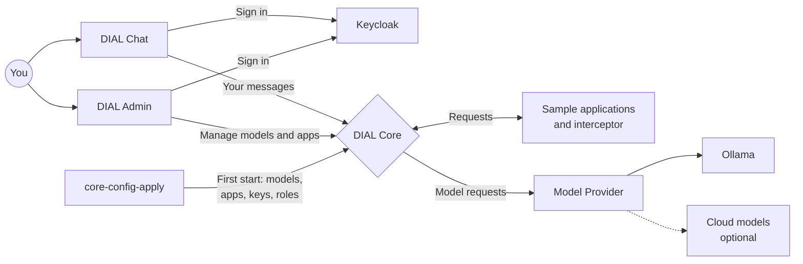

# 1. DIAL simple setup

The smallest complete DIAL: Chat, Admin and Core, with small open-source models
that run on your computer, and three sample applications written in Python.
No API keys or cloud account needed.

## Start

Give Docker Desktop at least 16 GB of memory (**Settings → Resources**), then
run in this folder:

```sh
docker compose up --wait
```

The command finishes when DIAL is ready. The first start downloads about 13 GB
of images and models, so it takes a while. To watch the model downloads, run
`docker compose logs -f ollama-init` in a second terminal.

> [!NOTE]
> **Apple Silicon Mac (M1 or newer)?** Before the first start, run
> `echo DIAL_PLATFORM=linux/amd64 >> .env` in this folder. Chat and Admin have
> no ARM build yet, so Docker runs them through emulation.
>
> **Only 8 GB of memory for Docker?** Run `echo OLLAMA_VISION_MODEL= >> .env`
> to skip LLaVA, the 4.7 GB picture model. Everything else works; AI Agent
> Sample just cannot look at pictures.

## Sign in

| Open | Sign in as | Password | What you get |
| --- | --- | --- | --- |
| Chat, <http://localhost:8055> | `dial` | `dial` | All models and applications |
| Chat, <http://localhost:8055> | `user` | `dial` | Only the basic models and Essay Assistant: see [Who can use what](#who-can-use-what) |
| DIAL Admin, <http://localhost:8056> | `dial-admin` | `dial` | Manage models, applications, API keys and roles |

## Things to try

1. **Chat with a model.** Sign in to Chat as `dial` and say hello to
   **qwen2.5**. It runs on your CPU, so the first answer can take a minute while
   the model loads.
2. **Use an application.** Select **Essay Assistant** and click one of its
   conversation starters. A DIAL *application* is your own code that Core calls
   just like a model. This one asks qwen2.5 for a short essay.
3. **Try an AI agent.** Select **AI Agent Sample**. Ask it to search the web,
   or attach a picture and ask what is in it.
4. **See an interceptor.** Select **qwen2.5 + pre/post interceptor** and send a
   message. The answer shows a *Greeting* and a *Goodbye* stage: an
   *interceptor* is code that Core runs around a model's answer.
5. **Look behind the scenes.** Sign in to DIAL Admin as `dial-admin` and open
   **AI Gateway** to see and change every model, application and interceptor.
6. **Call the API.** Everything Chat does goes through Core's API, which you
   can call too: see [Call the API](#call-the-api).

The code of the three samples is in [dial_entity_samples](dial_entity_samples/README.md),
with a guide to changing them and adding your own.

## Stop

```sh
docker compose down
```

Your chats, users and downloaded models are kept for the next start.

To delete everything and start from scratch, run `docker compose down -v`, then
delete the `core-data` and `logs` folders in the repository root. The next
start sets everything up again, including the models from `config.json`.

## What is running



Every request goes through DIAL Core. Core checks who is calling, then sends
the request to a model, through Model Provider, or to an application. The
sample applications call models back through Core.

| Service | What it does | Address on your computer |
| --- | --- | --- |
| `chat` | DIAL Chat: the web page where you talk to models | <http://localhost:8055> |
| `admin-frontend` | DIAL Admin: manage models, applications and other Core resources | <http://localhost:8056> |
| `core` | DIAL Core: one API in front of all models and applications | <http://localhost:8059> |
| `core-config-apply` | Copies `config.json` into Core on the first start, then stops | Not a server |
| `model-provider` | Connects Core to Ollama and to cloud model providers | Inside Docker only |
| `ollama` | Runs open-source models on your CPU | <http://localhost:8064> |
| `ollama-init` | Downloads the models into Ollama, then stops | Not a server |
| `essay-assistant-app` | Sample application: Essay Assistant | Inside Docker only |
| `agent-app-sample` | Sample application: AI Agent Sample | <http://localhost:8065> (use it through Chat) |
| `pre-post-interceptor` | Sample interceptor | Inside Docker only |
| `keycloak` | Sign-in: users, passwords and roles | <http://keycloak.localhost:8058/admin> (`admin` / `admin-password`) |
| `themes` | Colors, logos and model icons for Chat and Admin | <http://localhost:8063> |
| `redis` | Cache for Core | Inside Docker only |

All addresses work only on your computer (`127.0.0.1`).

## Models

| Deployment ID | What it is |
| --- | --- |
| `ollama-qwen2.5` | Chat model `qwen2.5:0.5b`, about 0.4 GB. Selected in Chat by default. |
| `ollama-llama3.2` | Chat model `llama3.2:1b`, about 1.3 GB |
| `ollama-all-minilm` | Embedding model `all-minilm`, about 46 MB. It turns text into 384 numbers; call it through the API. |
| `ollama-llava-vision` | Picture model `llava`, about 4.7 GB, used by AI Agent Sample |
| `ollama-qwen2.5-with-interceptor` | `qwen2.5:0.5b` again, with the sample interceptor |
| `gpt-4o`, `claude-sonnet-4`, `gemini` | Cloud models: hidden until you [set them up](#use-cloud-models) |

A *deployment ID* is the name that Chat and the API use for a model or
application. All of them are defined in
[`../core/config.json`](../core/config.json), which this setup copies into
Core on its first start.

That file also has the entities that only the
[advanced setup](../2-dial-advanced-setup/README.md) uses, so that upgrading
needs no extra step: the API key of Evaluation, and the **DIAL Scheduler**
application from [`../core/scheduler.json`](../core/scheduler.json). DIAL
Scheduler is listed here too, but it works only in the advanced setup, which
runs its service.

## Who can use what

Every user and API key has *roles*. A model or application can list the roles
that may use it in `userRoles`; with no list, every role may use it.

| Role | Who has it |
| --- | --- |
| `admin` | The user `dial` in Chat, and `dial-admin` in DIAL Admin |
| `user` | The user `user` |
| `default` | The API key `dial_api_key` |

| Models and applications | `userRoles` | Who can use them |
| --- | --- | --- |
| `ollama-qwen2.5`, `ollama-llama3.2`, `ollama-all-minilm` | Not set | Everyone |
| Essay Assistant | `user`, `admin`, `default` | Everyone |
| AI Agent Sample, `ollama-llava-vision`, `ollama-qwen2.5-with-interceptor` | `admin`, `default` | `dial` and `dial_api_key`, not `user` |
| `gpt-4o`, `claude-sonnet-4`, `gemini` | Empty | Nobody, until you add roles |

To give something to more users, add their role to it in DIAL Admin. Users get
their roles from Keycloak, in [`keycloak/realm-config.json`](keycloak/realm-config.json).

## Use cloud models

`gpt-4o`, `claude-sonnet-4` and `gemini` are set up but hidden, because they
need your own credentials. Model Provider, which already runs the local models,
also talks to these providers.

1. Add your credentials:
   - **OpenAI** (`gpt-4o`): in DIAL Admin, open the `gpt-4o` model and put your
     OpenAI API key into its upstream key.
   - **AWS Bedrock** (`claude-sonnet-4`): in `.env`, set `AWS_ACCESS_KEY_ID`,
     `AWS_SECRET_ACCESS_KEY` and `AWS_DEFAULT_REGION`.
   - **Google Vertex AI** (`gemini`): in `.env`, set `GCP_PROJECT_ID` and
     `VERTEXAI_REGION`, and save a Google credentials JSON file as
     `credentials/google.json` in this folder. The advanced setup uses this
     folder's `credentials/` too.

   After changing `.env`, run `docker compose up --wait`. In the advanced
   setup, use its own `.env`.
2. Make the model visible: in DIAL Admin, add the roles `admin` and `default`
   to the model.
3. Sign in to Chat as `dial` and select the model.

To use another cloud model, put its model ID into both `overrideName` and the
endpoint, such as `.../compat/bedrock/openai/deployments/<model ID>/chat/completions`.

Never commit real credentials. Git ignores `.env` and `credentials/`.

## Call the API

The API key `dial_api_key` comes from [`../core/config.json`](../core/config.json).

List the models and applications that the key can use:

```sh
curl http://localhost:8059/openai/models -H 'api-key: dial_api_key'
curl http://localhost:8059/openai/applications -H 'api-key: dial_api_key'
```

Chat with a model:

```sh
curl http://localhost:8059/openai/deployments/ollama-qwen2.5/chat/completions \
  -H 'api-key: dial_api_key' -H 'Content-Type: application/json' \
  -d '{"messages":[{"role":"user","content":"Say hello"}]}'
```

Call an application the same way, with its deployment ID:

```sh
curl http://localhost:8059/openai/deployments/essay-assistant-app/chat/completions \
  -H 'api-key: dial_api_key' -H 'Content-Type: application/json' \
  -d '{"messages":[{"role":"user","content":"Write an essay about reading."}]}'
```

Turn text into an embedding vector:

```sh
curl http://localhost:8059/openai/deployments/ollama-all-minilm/embeddings \
  -H 'api-key: dial_api_key' -H 'Content-Type: application/json' \
  -d '{"input":["Hello, DIAL"]}'
```

## Change settings

Everything works without changes. To change a port, a password or a model:

```sh
cp .env.example .env
# Edit .env, then apply it:
docker compose up --wait
```

`.env.example` explains every setting.

### Change a model

Docker Compose does not put `.env` values into JSON files, so a model change
takes two steps. For example, to run `qwen2.5:1.5b` as `ollama-qwen2.5`:

1. Set `OLLAMA_CHAT_MODEL=qwen2.5:1.5b` in `.env`, then run
   `docker compose up --wait` to download it.
2. In DIAL Admin, set the `overrideName` of `ollama-qwen2.5` to `qwen2.5:1.5b`.
   `ollama-qwen2.5-with-interceptor` uses the same model; change it too.

The other models work the same way, with `OLLAMA_SECOND_CHAT_MODEL`,
`OLLAMA_EMBEDDING_MODEL` and `OLLAMA_VISION_MODEL`. A bigger model gives better
answers, but needs more memory and is slower on a CPU.

### Apply config.json again

Core reads `../core/config.json` only on the first start
(see [how this works](../README.md#how-dial-core-gets-its-models-and-applications)).
To apply your edits to it later:

```sh
rm ../core-data/core-config-apply.json
docker compose up --wait
```

This overwrites the changes you made in Admin to the entities in that file.

## Files

In this folder:

| File | What it is |
| --- | --- |
| `docker-compose.yml` | Which services run and how they connect |
| `.env.example` | Optional settings: ports, passwords, models, cloud credentials |
| `dial_entity_samples/` | Source code of the sample applications and the interceptor |
| `keycloak/realm-config.json` | Users, passwords and roles. Keycloak reads it only on its first start. |
| `credentials/` | Optional Google credentials for Vertex AI, for both setups; ignored by Git |

In the repository root, shared with the advanced setup:

| File or folder | What it is |
| --- | --- |
| `core/` | Core's configuration: `config.json` with every model, application, interceptor, API key and role, the admin API key, and the `core-config-apply` service. See [core/README.md](../core/README.md). |
| `core-data/` | Core's storage: chats, files, models, applications, keys and roles |
| `logs/` | Core's request logs, one file per day |

## Troubleshooting

| Problem | What to do |
| --- | --- |
| `docker compose up` says a port is already allocated | Another program uses that port. Change the port in `.env`, for example `DIAL_CHAT_PORT=9055`. |
| The sign-in page does not open | Your system must resolve `keycloak.localhost` to your computer. Add the line `127.0.0.1 keycloak.localhost` to your hosts file. |
| `no matching manifest for linux/arm64` | You are on an Apple Silicon Mac. Run `echo DIAL_PLATFORM=linux/amd64 >> .env`, then `docker compose up --wait` again. |
| Services stop or restart by themselves | Docker has too little memory. Give it 16 GB, or skip the picture model with `OLLAMA_VISION_MODEL=` in `.env`. |
| Very slow on an Apple Silicon Mac | Turn on **Use Rosetta for x86_64/amd64 emulation** in Docker Desktop's **Settings → General**, and give Docker more CPUs in **Settings → Resources**. |
| `ollama-init` fails | It needs internet access the first time. Check `docker compose logs ollama-init`, then run `docker compose up --wait` again. |
| `core-config-apply` fails | Check `docker compose logs core-config-apply`: it names each entity that Core rejected, and why. Core stores nothing from a file that has an error. Fix the file, then run `docker compose up --wait` again. |
| You edited `config.json`, but nothing changed | Core reads it only on the first start. [Apply it again](#apply-configjson-again), or make the change in DIAL Admin. |
| A model or application is missing in Chat | Sign in as `dial`: some samples are not available to `user`. See [Who can use what](#who-can-use-what). |
| You changed a password in `.env`, but the old one still works | Keycloak reads passwords only on its first start. Change it in the Keycloak admin console, or [start from scratch](#stop). |

See what a service is doing with `docker compose logs <service>`, for example
`docker compose logs core`, and the status of all services with
`docker compose ps -a`.

## Next steps

- [Change the samples or write your own application](dial_entity_samples/README.md)
- [2-dial-advanced-setup](../2-dial-advanced-setup/README.md): Quick Apps,
  Scheduler, Evaluation and Analytics. You do not need to stop this setup
  first: starting the advanced one upgrades it in place.
