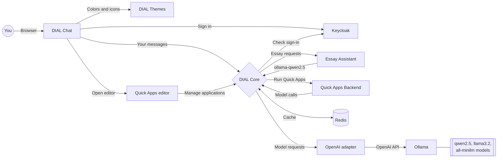

# 1. DIAL simple setup

The smallest DIAL you can run: a chat window, the DIAL Core gateway and three
small open-source models that run on your computer's CPU, plus an Essay Assistant
application powered by the local `ollama-qwen2.5` deployment and Quick Apps, which
build assistants without code.

## Start

```sh
docker compose up --wait
```

The command finishes when DIAL is ready. The first start downloads about 7 GB
of Docker images and models, so it takes a few minutes. To watch the model
downloads, run `docker compose logs -f ollama-init` in a second terminal.

On a Mac with Apple Silicon (M1 or newer), first run
`echo DIAL_PLATFORM=linux/amd64 >> .env` in this folder. DIAL Chat and Quick
Apps have no ARM build yet, so this tells Docker to run them through emulation.
Windows, Linux and Intel Macs need nothing.

Open <http://localhost:8055> and sign in:

| Username | Password | Can do |
| --- | --- | --- |
| `user` | `dial` | Chat with models |
| `dial` | `dial` | Chat with models, plus Chat admin actions |

## Stop

```sh
docker compose down
```

Your chats, users and the downloaded model are kept for the next start. To
delete them too and start from scratch, run `docker compose down -v`, then
delete the `core-data` and `logs` folders in the repository root.

## What is running



| Service | What it does | Address on your computer |
| --- | --- | --- |
| `chat` | The web page where you talk to models | <http://localhost:8055> |
| `core` | DIAL Core: one API in front of all models and applications | <http://localhost:8059> |
| `keycloak` | Sign-in: users, passwords and roles | <http://keycloak.localhost:8058/admin> (`admin` / `admin-password`) |
| `themes` | Colors, logos and model icons for Chat | <http://localhost:8063> |
| `adapter-dial-openai` | Translates DIAL requests for OpenAI-compatible models | Inside Docker only |
| `essay-assistant-app` | Writes short essays using `ollama-qwen2.5` through Core | Inside Docker only |
| `quickapps-backend` | Runs Quick Apps | Inside Docker only |
| `quickapps-frontend` | The Quick Apps editor, opened from an application's settings in Chat | <http://localhost:8057> |
| `ollama` | Runs open-source models on your CPU | <http://localhost:8064> |
| `ollama-init` | Downloads the models into Ollama, then stops | Not a server |
| `redis` | Fast cache for Core | Inside Docker only |

## Files

In this folder:

| File | What it is |
| --- | --- |
| `docker-compose.yml` | Which services run and how they connect |
| `dial_entity_samples/essay_assistant_app/` | Essay Assistant source, Dockerfile and Python dependencies |
| `keycloak/realm-config.json` | Users, passwords and sign-in clients. Read only on Keycloak's first start. |
| `.env.example` | Optional settings: ports, passwords, model, versions |

DIAL Core's folders are in the repository root, because the advanced setup
uses them too:

| File or folder | What it is | Inside the `core` container |
| --- | --- | --- |
| `../core/1-dial-simple-setup/config.json` | Core's applications, models, API keys and roles. Core re-reads it every 3 seconds, so edits apply without a restart. | `/opt/config/1-dial-simple-setup/config.json` |
| `../core/1-dial-simple-setup/quick-apps-schemas.json` | Registers the Quick Apps application type in Core | `/opt/config/1-dial-simple-setup/quick-apps-schemas.json` |
| `../core/settings.json` | Core's server settings | `/opt/config/settings.json` |
| `../core/gflog.xml` | Where Core writes its logs | `/opt/config/gflog.xml` |
| `../core-data/` | Core's storage: your chats and files. Created on the first start. | `/app/data` |
| `../logs/` | Core's request logs, one file per day. Created on the first start. | `/app/log` |

## Models

| Core deployment ID | Ollama model | Kind | Setting in `.env` |
| --- | --- | --- | --- |
| `ollama-qwen2.5` | `qwen2.5:0.5b` (about 0.4 GB) | Chat, selected in Chat by default | `OLLAMA_CHAT_MODEL` |
| `ollama-llama3.2` | `llama3.2:1b` (about 1.3 GB) | Chat | `OLLAMA_SECOND_CHAT_MODEL` |
| `ollama-all-minilm` | `all-minilm` (about 46 MB) | Embeddings: turns text into 384 numbers | `OLLAMA_EMBEDDING_MODEL` |

In Chat, pick a chat model in the model selector. Embedding models do not chat;
call them through the API.

Select **Essay Assistant** in Chat to write a short essay. Its conversation
starters are available in the application settings. Compose sets `DIAL_MODEL`
to `ollama-qwen2.5`, which routes through Core and the OpenAI adapter to Ollama.
After changing the assistant's code or dependencies, rebuild it with
`docker compose up --wait --build essay-assistant-app`.

## Quick Apps

To build an assistant without code, create a Quick App in Chat, open its
settings and select a model that supports tools, such as `ollama-qwen2.5`.

`../core/1-dial-simple-setup/quick-apps-schemas.json` registers the Quick Apps
application type, as described in
[quickapps-be-schema-info.md](../readmes/quickapps-be-schema-info.md). Core
fetches the full schema from `quickapps-backend` at
`/v1/configuration-support/application-schema`, so it always matches the
backend. That is why Core waits for the backend's health check before starting.

The editor has its own `dial-quickapps` Keycloak client. Chat and the editor
use separate cookie names on `localhost`, so the editor works inside Chat's
pages without third-party cookies. Code interpreter, web fetch and preview
attachments are turned off because those services are not deployed.

`dial:applicationTypeEditorUrl` in the schema file is the literal
`http://localhost:8057`. If you change `QUICKAPPS_FRONTEND_PORT`, change it too.

## Try the API

Everything Chat does goes through Core's API. You can call it yourself with
the API key `dial_api_key` from `../core/1-dial-simple-setup/config.json`:

```sh
curl http://localhost:8059/openai/deployments/ollama-qwen2.5/chat/completions \
  -H 'api-key: dial_api_key' -H 'Content-Type: application/json' \
  -d '{"messages":[{"role":"user","content":"Say hello"}]}'
```

Ask the Essay Assistant to write an essay:

```sh
curl http://localhost:8059/openai/deployments/essay-assistant-app/chat/completions \
  -H 'api-key: dial_api_key' -H 'Content-Type: application/json' \
  -d '{"messages":[{"role":"user","content":"Write an essay about reading."}]}'
```

Turn text into an embedding vector:

```sh
curl http://localhost:8059/openai/deployments/ollama-all-minilm/embeddings \
  -H 'api-key: dial_api_key' -H 'Content-Type: application/json' \
  -d '{"input":["Hello, DIAL"]}'
```

List the models that Core knows:

```sh
curl http://localhost:8059/openai/models -H 'api-key: dial_api_key'
```

## Change settings

Everything works without changes. To change a port, password or a model:

```sh
cp .env.example .env
# Edit .env, then apply it:
docker compose up --wait
```

Docker Compose does not put `.env` values into JSON files. For example, to use
another Ollama model for `ollama-qwen2.5`, change both:

1. `OLLAMA_CHAT_MODEL` in `.env`, such as `qwen2.5:1.5b`;
2. `overrideName` of `ollama-qwen2.5` in `../core/1-dial-simple-setup/config.json`, to the same name.

The other models work the same way, with the settings from the [Models](#models) table.

A bigger model gives better answers but needs more memory and is slower on a CPU.

## Next step

When you are ready for more, go to [2-dial-advanced-setup](../2-dial-advanced-setup/README.md).
You do not need to stop this setup first: starting the advanced one upgrades
it in place.

## Troubleshooting

| Problem | What to do |
| --- | --- |
| `docker compose up` says a port is already allocated | Another program uses that port. Change the port in `.env`, for example `DIAL_CHAT_PORT=9055`. |
| The sign-in page does not open | Your system must resolve `keycloak.localhost` to your computer. Add the line `127.0.0.1 keycloak.localhost` to your hosts file. |
| Services stop or restart by themselves | Docker has too little memory. Give it at least 8 GB in Docker Desktop's **Settings → Resources**. |
| `ollama-init` fails | It needs an internet connection the first time. Run `docker compose logs ollama-init` to see why, then run `docker compose up --wait` again. |
| `no matching manifest for linux/arm64` | You are on an Apple Silicon Mac, and Chat and Quick Apps have no ARM build. Run `echo DIAL_PLATFORM=linux/amd64 >> .env`, then `docker compose up --wait` again. |
| Very slow on an Apple Silicon Mac | Chat and Quick Apps run through emulation. Turn on **Use Rosetta for x86_64/amd64 emulation** in Docker Desktop's **Settings → General**. Models answer slowly on the CPU: give Docker more CPUs in **Settings → Resources**. |
| You changed a password in `.env`, but the old one still works | Keycloak applies `realm-config.json` only on its first start. Change the password in the Keycloak admin console, or start from scratch as described in [Stop](#stop). |

See what a service is doing with `docker compose logs <service>`, for example
`docker compose logs core`. See the status of all services with
`docker compose ps -a`.
