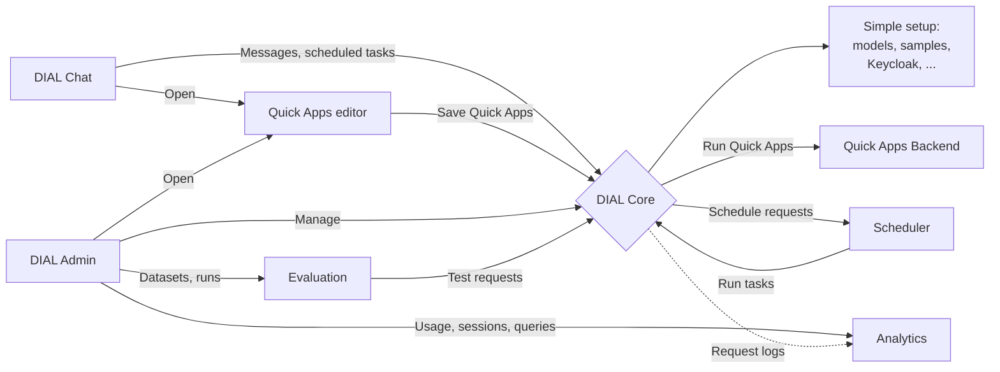

# 2. DIAL advanced setup

Everything from [1-dial-simple-setup](../1-dial-simple-setup/README.md), plus:

- **Quick Apps**: build assistants in Chat without writing code;
- **Scheduler**: run applications on a schedule;
- **Evaluation**: test models and applications against datasets, with metrics;
- **Analytics**: usage, sessions and SQL queries in DIAL Admin.

The models, sample applications, users and roles are the same as in the simple
setup.

## Start

Give Docker Desktop at least 16 GB of memory (**Settings → Resources**), then
run in this folder:

```sh
docker compose up --wait
```

The command finishes when DIAL is ready. The first start downloads about 7 GB
more than the simple setup.

If the simple setup is running, you do not need to stop it: this command
upgrades it in place and keeps its users, chats and models.

> [!NOTE]
> **Apple Silicon Mac (M1 or newer)?** Before the first start, run
> `echo DIAL_PLATFORM=linux/amd64 >> .env` in this folder, even if you did it
> for the simple setup: each folder has its own `.env`.

## Open

| What | Address | Sign in as |
| --- | --- | --- |
| Chat | <http://localhost:8055> | `dial` / `dial` for everything, or `user` / `dial` |
| DIAL Admin | <http://localhost:8056> | `dial-admin` / `dial` |
| Quick Apps editor | Opens from a Quick App's settings in Chat | Signs you in automatically |
| Core API | <http://localhost:8059> | Header `api-key: dial_api_key` |
| Keycloak admin console | <http://keycloak.localhost:8058/admin> | `admin` / `admin-password` |

The other services have their own API pages; see [Service APIs](#service-apis).

## Things to try

1. **Build an assistant without code.** In Chat, create a Quick App, open its
   settings and select a model that supports tools, such as `ollama-qwen2.5`.
2. **Evaluate a model.** In DIAL Admin, open **Evaluation** and create a
   dataset, a test suite and a run.
3. **See your usage.** Send a few messages in Chat, then open **Analytics** in
   DIAL Admin. New requests appear within about 15 seconds, and sessions within
   15 minutes.
4. **Schedule a task.** Open **Scheduled tasks** in Chat's sidebar. It needs
   a one-time setup first: see [Scheduler](#scheduler).
5. **Everything from the simple setup**: its
   [things to try](../1-dial-simple-setup/README.md#things-to-try) work here too.

## Stop

```sh
docker compose down
```

Always stop from the folder you started from. Your data is kept for the next
start. To delete everything and start from scratch, run `docker compose down -v`,
then delete the `core-data` and `logs` folders in the repository root.

To go back to the simple setup, run `docker compose down` here, then
`docker compose up --wait` in `../1-dial-simple-setup`.

## What is running



| Group | Services added by this setup | What they do |
| --- | --- | --- |
| Quick Apps | `quickapps-backend`, `quickapps-frontend` | Run Quick Apps; the editor at <http://localhost:8057> |
| Scheduler | `scheduler`, `scheduler-worker`, `scheduler-postgres` | Accept schedules, run them on time, and keep them in PostgreSQL |
| Evaluation | `evaluation-backend`, `evaluation-metrics`, `evaluation-postgres` | Run test suites, calculate metrics, and keep the results |
| Analytics | `logger`, `analytics-blob`, `analytics`, `analytics-clickhouse`, `analytics-postgres`, `analytics-enrichment-runner`, `analytics-init` | Collect Core's request logs and make them searchable |

Analytics works like this: Core writes a line to `../logs` for every request.
Vector (`logger`) uploads the lines to a local Azure Blob Storage emulator
(`analytics-blob`). The Analytics service (ADAS) loads them into ClickHouse,
and the Enrichment Runner adds session information on top.

## How this folder extends the simple setup

This folder does not copy the simple setup. Its `docker-compose.yml` includes
it, and `simple-setup-overrides.yml` changes three of its services:

| Service | Change |
| --- | --- |
| `chat` | Turns on **Scheduled tasks** and allows the Quick Apps editor |
| `admin-frontend` | Turns on **Evaluation** and **Analytics** |
| `core` | Reads the Quick Apps application type, signs users in for Scheduler, and logs a few client headers for Analytics |

This setup adds no models or applications of its own. The simple setup's
`core-config-apply` puts every model, application, interceptor, API key and
role into Core on the first start, including the ones that only this setup
uses: the Scheduler application and the Evaluation API key (see
[how this works](../README.md#how-dial-core-gets-its-models-and-applications)).
So upgrading a running simple setup changes nothing in Core's storage.

## Quick Apps

A Quick App is an assistant that you configure in a form instead of writing
code: instructions, a model, tools. Quick Apps Backend runs them.

`../core/quick-apps-schemas.json` tells Core about the
Quick Apps application type, and Core reads the full form from Quick Apps
Backend when it starts. It contains the editor's address,
`http://localhost:8057`: if you change `QUICKAPPS_FRONTEND_PORT`, change it there
too.

Code interpreter, web fetch and file previews are turned off, because their
services are not part of this setup.

## Scheduler

[DIAL Scheduler](https://github.com/epam/ai-dial-scheduler) runs DIAL
applications and HTTP requests on a schedule, from **Scheduled tasks** in Chat,
REST or MCP. A scheduled task runs while you are away, on your behalf, so it
needs your permission once:

1. Sign in to Chat as `dial` and enable offline access in Chat.
2. Allow the Scheduler application to use those credentials. As an
   administrator, run once:

   ```sh
   curl --fail -X POST \
     http://localhost:8059/v1/applications/public/dial_scheduler/external-services/dial-native/consent \
     -H 'api-key: dial_admin_api_key'
   ```

   This allows it for every user who has turned on offline access.

Without both steps, creating a schedule fails. For the details, see the
Scheduler's [credential setup](https://github.com/epam/ai-dial-scheduler#per-user-credentials-dial-native-offline-delegation).

| Service | What it does |
| --- | --- |
| `scheduler` | Accepts schedules from Chat, REST and MCP |
| `scheduler-worker` | Runs tasks when they are due. Keep only one, so tasks do not run twice. |
| `scheduler-postgres` | Keeps schedules and run history |

Scheduler's REST API is available through Core, at
`http://localhost:8059/v1/deployments/applications/public/dial_scheduler/route/v1/schedules/`.
Call it through Core, so that Scheduler knows which user is calling.

## Evaluation

In DIAL Admin, open **Evaluation**: Datasets, Test Suites and Runs.

- The Evaluation services call Core with the API key `dial_evaluation_api_key`
  from `../core/config.json`.
- Metrics that need an AI judge use `ollama-qwen2.5`, and embedding-based
  metrics use `ollama-all-minilm` (`EVALUATION_JUDGE_MODEL` and
  `EVALUATION_EMBEDDING_MODEL` in `.env`). The small qwen2.5 model is enough to
  see that everything works; use a stronger judge for meaningful scores.
  Metrics such as `exact_match` and `regex_match` need no judge.

## Analytics

In DIAL Admin, open **Analytics**: Dashboards, Queries, Sessions, Tables and
Pipelines.

- On the first start, `analytics-init` imports the recommended tables and
  pipelines from `analytics/adas-catalog.json`. Later starts keep your changes.
- Analytics stores the full text of requests and answers: by default for 90
  days, and usage numbers for a year. Keep that in mind before you send
  anything private.
- To let the **Queries** page write SQL for you, set
  `DIAL_QUERY_ASSISTANT_DEPLOYMENT` in `.env` to a model's deployment ID.

## Change settings

Everything works without changes. To change something:

```sh
cp .env.example .env
# Edit .env, then apply it:
docker compose up --wait
```

Use **this folder's** `.env` for all settings, including the simple setup's
ones such as `OLLAMA_CHAT_MODEL` or `DIAL_CHAT_PORT`.

After changing the code of a sample in `../1-dial-simple-setup/dial_entity_samples`,
rebuild it from this folder:

```sh
docker compose up --wait --build agent-app-sample
```

## Files and data

In this folder:

| File or folder | What it is |
| --- | --- |
| `docker-compose.yml` | The services this setup adds |
| `simple-setup-overrides.yml` | The changes to the simple setup's services |
| `.env.example` | Optional settings: ports, passwords, models, versions |
| `analytics/` | Analytics settings: Vector, ClickHouse, the recommended catalog and its initializer |
| `evaluation/init-db.sql` | Creates the second Evaluation database on the first start |

In the repository root:

| File or folder | What it is |
| --- | --- |
| `core/` | Core's configuration, shared with the simple setup. This setup also uses `core/quick-apps-schemas.json`, the Quick Apps application type. See [core/README.md](../core/README.md). |
| `core-data/`, `logs/` | Core's storage and request logs, shared with the simple setup |

Docker volumes keep the data of the other services: Keycloak users
(`dial_keycloak-data`), downloaded models (`dial_ollama-data`), and one volume
for each database. `docker compose down -v` deletes them.

Keep `core-data/` and `dial_keycloak-data` together: Core keeps each user's
chats under their Keycloak user ID. If you delete only the volume, Keycloak
creates the users again with new IDs, and they lose their chats.

## Service APIs

| Service | Address | Access |
| --- | --- | --- |
| Evaluation Backend | <http://localhost:8060/swagger-ui.html> | Keycloak token of `dial-admin` |
| Evaluation Metrics | <http://localhost:8061/docs> | Open |
| Analytics (ADAS) | <http://localhost:8062/swagger-ui.html> | Header `api-key: dial_admin_api_key`, or a Keycloak token of `dial-admin` |
| Analytics Enrichment Runner | <http://localhost:8066/actuator/health/readiness> | Health is open; everything else needs a Keycloak token of `dial-admin` |
| Scheduler | <http://localhost:8067/docs> | Call it through Core, as described in [Scheduler](#scheduler) |
| Themes | <http://localhost:8063> | Open |
| Ollama | <http://localhost:8064> | Open |

Check that everything is up:

```sh
docker compose ps -a
curl --fail http://localhost:8059/openai/models -H 'api-key: dial_api_key'
curl --fail http://localhost:8060/api/v1/health
curl --fail http://localhost:8061/health
curl --fail http://localhost:8062/actuator/health/readiness
curl --fail http://localhost:8066/actuator/health/readiness
curl --fail http://localhost:8067/ready
```

Count the requests that Analytics has loaded:

```sh
curl http://localhost:8062/v1/queries/execute-sql \
  -H 'api-key: dial_admin_api_key' -H 'Content-Type: application/json' \
  -d '{"sql":"SELECT count(*) AS requests FROM dial_usage_log"}'
```

## Troubleshooting

| Problem | What to do |
| --- | --- |
| **Scheduled tasks** is missing in Chat | Run `docker compose up -d --wait chat` from this folder, then reload Chat. |
| Creating a scheduled task fails | Do the one-time [Scheduler](#scheduler) setup. |
| Services stop or restart by themselves, or LLaVA fails to load | Docker has too little memory. Give it at least 16 GB. |
| `docker compose up` says a port is already allocated | Change the port in this folder's `.env`. |
| Things broke after you started the simple setup while this one was running | Run `docker compose up --wait` here again. |
| A sample does not pick up your code changes | Run `docker compose up --wait --build <service>` from this folder. |
| AI Agent Sample's web search finds nothing | DuckDuckGo sometimes shows a bot check. The agent says that the search failed; try again later. |
| Analytics shows usage but no sessions | Wait up to 15 minutes. In DIAL Admin, check that the pipelines `usage-client-identity-live` and `sessions_rollup` are enabled. |
| Analytics does not start after updating these samples | Delete the `DIAL_ANALYTICS_VERSION` line from `.env`, then run `docker compose up --wait --remove-orphans`. Check `docker compose logs analytics analytics-init`. |

See also the simple setup's [troubleshooting](../1-dial-simple-setup/README.md#troubleshooting),
and the [DIAL documentation](https://docs.dialx.ai) for each service.

## Updating from InfluxDB analytics

Earlier versions of this setup kept analytics in InfluxDB. To switch, delete any
`DIAL_ANALYTICS_VERSION` line from `.env`, then run:

```sh
docker compose up --wait --remove-orphans
```

This removes the InfluxDB container but keeps its volume. Old InfluxDB data is
not moved, but Vector loads every request whose log is still in `../logs`.
