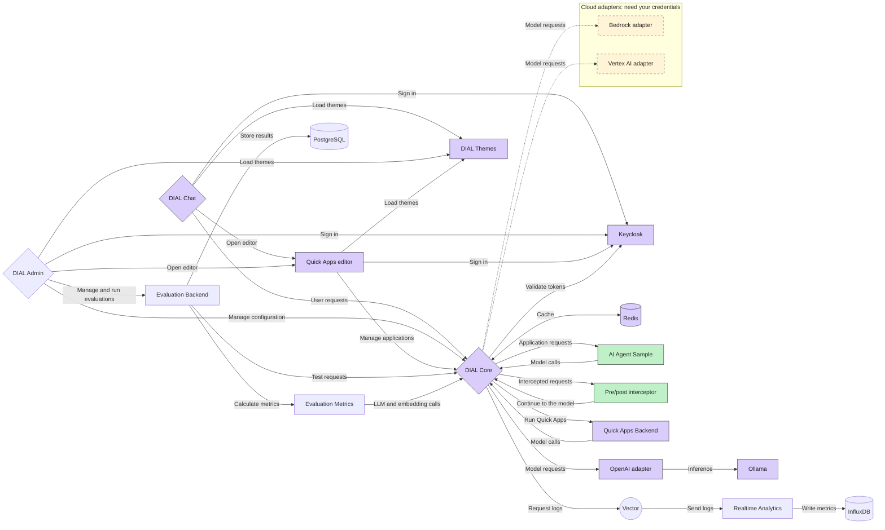

# 2. DIAL advanced setup

Everything from [1-dial-simple-setup](../1-dial-simple-setup/README.md), plus:

- **DIAL Admin**: manage models, applications and evaluations in a web UI;
- **Evaluation**: test models with datasets and metrics;
- **Analytics**: collect usage data from every request;
- **Two DIAL entities written in Python**, in [dial_entity_samples](dial_entity_samples/README.md):
  an AI agent application and an interceptor;
- **Access by role**: in Chat, the user `user` sees only the simple setup's
  models and applications, the user `dial` sees everything (see [Roles](#roles)).

## Start

Give Docker at least **16 GB of memory** (Docker Desktop: **Settings → Resources**),
then run from this folder:

```sh
docker compose up --wait
```

The command finishes when DIAL is ready. The first start downloads about 12 GB
more than the simple setup, including the LLaVA picture model, so it takes a
while. To watch the model downloads, run `docker compose logs -f ollama-init`
in a second terminal.

If the simple setup is running, you do not need to stop it: this command
upgrades it in place and keeps its users, chats and models.

On a Mac with Apple Silicon (M1 or newer), first run
`echo DIAL_PLATFORM=linux/amd64 >> .env` in this folder, even if you did it
for the simple setup: each folder has its own `.env`. Chat, Admin, Quick Apps,
Evaluation and Analytics have no ARM build yet, so Docker runs them through
emulation.

## Open

| What | Address | Sign in with |
| --- | --- | --- |
| Chat | <http://localhost:8055> | `user` / `dial` for the simple setup's models, or `dial` / `dial` for everything and Chat admin |
| DIAL Admin | <http://localhost:8056> | `dial-admin` / `dial` |
| Quick Apps editor | Opens from an application's settings in Chat or Admin | Signs you in automatically |
| Keycloak admin console | <http://keycloak.localhost:8058/admin> | `admin` / `admin-password` |
| Core API | <http://localhost:8059> | Header `api-key: dial_api_key` |
| Evaluation Backend API | <http://localhost:8060/swagger-ui.html> | A Keycloak token of `dial-admin` |
| Evaluation Metrics API | <http://localhost:8061/docs> | Nothing |
| InfluxDB | <http://localhost:8062> | `admin` / `influxdb-password` |
| Themes | <http://localhost:8063> | Nothing |
| Ollama API | <http://localhost:8064> | Nothing |
| AI Agent Sample | <http://localhost:8065> | Use it through Chat |

All addresses work only on your computer (`127.0.0.1`).

## Things to try

1. **Chat with the AI agent.** Sign in to Chat as `dial`, open the catalog and select
   **AI Agent Sample**. Ask it to search the web, or attach a picture and ask
   what is in it. The code is in
   [dial_entity_samples/agent_app_sample](dial_entity_samples/agent_app_sample/README.md).
2. **See an interceptor at work.** Select **qwen2.5 + pre/post interceptor**
   and send a message. The answer shows a *Greeting* and a *Goodbye* step that
   the interceptor added. The code is in
   [dial_entity_samples/pre_post_interceptor_sample](dial_entity_samples/pre_post_interceptor_sample/README.md).
3. **Look at DIAL as an administrator.** Sign in to Admin as `dial-admin` and
   open **AI Gateway** to see every model, application and interceptor.
4. **Evaluate a model.** In Admin, open **Evaluation** and create a dataset,
   a test suite and a run.
5. **Compare the two users.** Sign in to Chat as `user`, then as `dial`, and
   compare the model lists. See [Roles](#roles).

## Stop

```sh
docker compose down
```

Always stop from the folder you started from. Your data is kept for the next
start. To delete it too and start from scratch, run `docker compose down -v`,
then delete the `core-data` and `logs` folders in the repository root.

To go back to the simple setup, run `docker compose down` here, then
`docker compose up --wait` in `../1-dial-simple-setup`.

## What is running



Purple services come from the simple setup. Green ones are the DIAL entity
samples built from this folder. The yellow cloud adapters run, but their models
stay hidden until you add your cloud credentials.

| Group | Services added by this setup |
| --- | --- |
| DIAL entity samples | `agent-app-sample`, `pre-post-interceptor` |
| Admin | `admin-frontend` |
| Evaluation | `evaluation-backend`, `evaluation-metrics`, `evaluation-postgres` |
| Analytics | `logger` (Vector), `analytics`, `influxdb` |
| Cloud adapters | `adapter-dial-bedrock`, `adapter-dial-vertexai` |

## How this folder extends the simple setup

This folder does not copy the simple setup. `docker-compose.yml` includes it:

```yaml
include:
  - path:
      - ../1-dial-simple-setup/docker-compose.yml
      - ./simple-setup-overrides.yml
```

Docker Compose loads the simple setup's services, then merges
`simple-setup-overrides.yml` into them. That file is the only place where this
setup changes a simple-setup service:

| Service | Change |
| --- | --- |
| `core` | Also reads `../core/2-dial-advanced-setup/config.json` |
| `ollama-init` | Also downloads LLaVA |

DIAL Core's configuration is in the repository root, in `../core`. Core reads
these files in this order and merges them:

1. `../core/1-dial-simple-setup/config.json`: the qwen2.5, llama3.2 and all-minilm
   models, Essay Assistant, API keys and roles;
2. `../core/1-dial-simple-setup/quick-apps-schemas.json`: the Quick Apps
   application type;
3. `../core/2-dial-advanced-setup/config.json`: the agent application, the
   interceptor, more models, the Evaluation API key, the `ConfigAdmin` role,
   and which roles may use each model and application.

Both setups share the project name `dial`, and therefore the same containers,
network and volumes. They also share Core's storage in `../core-data` and its
request logs in `../logs`.

## Files

In this folder:

| File or folder | What it is |
| --- | --- |
| `docker-compose.yml` | The services this setup adds |
| `simple-setup-overrides.yml` | The changes to the simple setup's services |
| `dial_entity_samples/` | Python source code of the agent application and the interceptor |
| `evaluation/init-db.sql` | Creates the Evaluation results database on PostgreSQL's first start |
| `analytics/vector.yaml` | Tells Vector where to read Core's logs and where to send them |
| `.env.example` | Optional settings: ports, passwords, models, cloud credentials, versions |

In the repository root, shared with the simple setup:

| File or folder | What it is |
| --- | --- |
| `../core/2-dial-advanced-setup/config.json` | Applications, interceptors, models, API keys and roles that this setup adds to Core |
| `../core/1-dial-simple-setup/` | The simple setup's models, applications, API keys and Quick Apps type, which this setup keeps |
| `../core/settings.json`, `../core/gflog.xml` | Core's server and log settings |
| `../core-data/` | Core's storage: chats, files, resources created in Admin |
| `../logs/` | Core's request logs, which Vector sends to analytics |

Core re-reads the JSON files every 3 seconds, so edits apply without a restart.

## Change settings

Everything works without changes. To change something:

```sh
cp .env.example .env
# Edit .env, then apply it:
docker compose up --wait
```

Use **this folder's** `.env` for all settings, including the simple setup's
ones such as `OLLAMA_CHAT_MODEL` or `DIAL_CHAT_PORT`. Docker Compose does not
put `.env` values into JSON files: when a setting names a value that also
appears in `../core/**/*.json`, `.env.example` says what to change there too.

When you change the code in `dial_entity_samples`, rebuild and restart it:

```sh
docker compose up --wait --build agent-app-sample pre-post-interceptor
```

## Details

### DIAL Admin without Admin Backend

Admin talks to Core directly (`DIAL_CORE_API_URL=http://core:8080`) and leaves
`DIAL_ADMIN_API_URL` unset. It forwards the signed-in user's token to Core.
Core treats users with the `admin` role as administrators; `dial-admin`
receives it through the `dial-admin-console` client roles in Keycloak.

Use the **AI Gateway**, **Artifacts** and **Governance** sections. The
**Entities**, **Builders**, **Access Management** and **Audit** menus are
hidden because they need the Admin Backend, which is not deployed.
Whole-configuration import and export are not available either.

The JSON files hold file-defined defaults. Resources that you create in Admin
are stored in Core's storage (the `../core-data` folder); Admin never rewrites
the JSON files.

### Evaluation

Sign in to Admin as `dial-admin` and open **Evaluation**: Datasets, Test Suites
and Runs.

- Admin calls `evaluation-backend`, forwarding the user's Keycloak token. The
  backend accepts the `admin` and `ConfigAdmin` roles.
- The backend and Evaluation Metrics call Core with the API key
  `dial_evaluation_api_key` from `../core/2-dial-advanced-setup/config.json`. If you change
  `DIAL_EVALUATION_API_KEY` in `.env`, change the key there too.
- `evaluation-metrics` supplies the metric catalog and calculations, including
  RAG metrics. The backend syncs the catalog at startup and every five minutes.
- PostgreSQL keeps metadata in `evaluation_db` and results in
  `evaluation_analytics_db`. Keep `EVALUATION_POSTGRES_PASSWORD` unchanged
  while you keep its data.

The judge and embedding models are `ollama-qwen2.5` and
`ollama-all-minilm` (`EVALUATION_JUDGE_MODEL` and
`EVALUATION_EMBEDDING_MODEL` in `.env`). The small qwen2.5 model is enough to
check that everything is connected; use a stronger judge model for meaningful
LLM-based scores. Metrics such as `exact_match` and `regex_match` do not use a
judge model.

### Analytics

Core writes a log line for every request to the `../logs` folder. Vector
(`logger`) reads these logs and sends them to `analytics`, which writes usage
metrics to InfluxDB. Optional topic-model downloads are turned off.

Admin's newer **Analytics** section (Dashboards, Queries, Sessions, Tables,
Pipelines) needs a separate service, the
[Analytics data-access service](../readmes/analytics-data-access-service-README.md),
which this setup does not deploy. To connect one, set its base URL, reachable
from the `admin-frontend` container, in `.env`, then recreate Admin:

```sh
# In .env, for a service running on your computer:
# DIAL_ANALYTICS_API_URL=http://host.docker.internal:<port>
docker compose up --wait --no-deps admin-frontend
```

| Admin variable | Meaning |
| --- | --- |
| `DIAL_ANALYTICS_API_URL` | Base URL of the data-access service. Setting it shows the Analytics section. |
| `DIAL_ANALYTICS_RUNNER_API_URL` | Optional enrichment runner for pipeline runtime controls |
| `DIAL_QUERY_ASSISTANT_DEPLOYMENT` | Optional Core deployment for the Queries AI view |

The data-access service must accept tokens from the same Keycloak realm. The
InfluxDB metrics above are not migrated into it.

### Roles

This setup uses the three roles of the simple setup to decide who sees what.
Each model and application lists its roles in `userRoles` in
`../core/2-dial-advanced-setup/config.json`:

| Models and applications | `userRoles` | Signed-in users who see them |
| --- | --- | --- |
| From the simple setup: `ollama-qwen2.5`, `ollama-llama3.2`, `ollama-all-minilm`, Essay Assistant | `user`, `admin`, `default` | `user` and `dial` |
| Added by this setup: AI Agent Sample, `ollama-qwen2.5-with-interceptor`, `ollama-llava-vision` | `admin`, `default` | `dial` only |

| Role | Who has it |
| --- | --- |
| `user` | The user `user` |
| `admin` | The user `dial`, and `dial-admin` in DIAL Admin |
| `default` | The API keys `dial_api_key` and `dial_evaluation_api_key`, so the API examples and Evaluation reach every model |

Users get their roles from `../1-dial-simple-setup/keycloak/realm-config.json`,
which already has them on Keycloak's first start, for both setups. An
application calls models with the roles of the user who called it, so the user
`user` cannot reach LLaVA through another application either.

Core merges its configuration files, so this setup adds `userRoles` to the
simple setup's models without changing `../core/1-dial-simple-setup/config.json`.
The simple setup alone sets no `userRoles`: there, every user sees every model.
To give a model or application to more users, add their role to its `userRoles`.

### Models

| Core deployment ID | Ollama model | Used by |
| --- | --- | --- |
| `ollama-qwen2.5` | `qwen2.5:0.5b` | Chat, AI Agent Sample, Quick Apps, Evaluation judge |
| `ollama-llama3.2` | `llama3.2:1b` | Chat |
| `ollama-all-minilm` | `all-minilm` | Evaluation embeddings |
| `ollama-qwen2.5-with-interceptor` | `qwen2.5:0.5b` | The interceptor sample |
| `ollama-llava-vision` | `llava` | Picture analysis in AI Agent Sample |

The first three come from the simple setup.

To change an Ollama model, change its `overrideName` in the JSON and its
`OLLAMA_*_MODEL` download name in `.env`. An empty `OLLAMA_VISION_MODEL` skips
the LLaVA download. LLaVA runs on the CPU: the first picture takes up to a
minute, while the model loads.

The cloud models `gpt-4o`, `claude-sonnet-4` and `gemini` are configured but
hidden (`"userRoles": []`). To use one, configure its provider, then give it
roles such as `["admin", "default"]` in `../core/2-dial-advanced-setup/config.json`:

- **OpenAI:** put your key into the `gpt-4o` upstream `key`. The adapter is
  already running.
- **AWS Bedrock:** set the AWS credentials and region in `.env`. Put the
  Bedrock model ID or inference profile ID into both `overrideName` and the
  endpoint path.
- **Google Vertex AI:** set `GCP_PROJECT_ID` and `VERTEXAI_REGION` in `.env`,
  and save an ADC JSON file as `credentials/google.json` in this folder. Put
  the model ID into both `overrideName` and the endpoint path.

Both adapters always run; apply a `.env` change with `docker compose up --wait`.
Never commit real credentials: `.env` and `credentials/` are ignored by Git.

### Data

These folders and Docker volumes keep all data between restarts:

| Folder or volume | Contents |
| --- | --- |
| `../core-data/` folder | Core storage: chats, files, resources created in Admin |
| `../logs/` folder | Core request logs for analytics |
| `dial_keycloak-data` | Keycloak users and sessions |
| `dial_ollama-data` | Downloaded models |
| `dial_evaluation-postgres-data` | Evaluation datasets, suites and results |
| `dial_influxdb-data`, `dial_influxdb-config` | Usage metrics |
| `dial_vector-data` | Vector's read position and buffer |

Keycloak reads `../1-dial-simple-setup/keycloak/realm-config.json` only when it
creates the realm on its first start. Likewise, InfluxDB and PostgreSQL apply
their initial credentials only on their first start. Keep Core's encryption
settings unchanged while you keep its data.

Core keeps each user's chats in `../core-data/dial/core/Users/<Keycloak user ID>/`.
Keep `../core-data` and the `dial_keycloak-data` volume together: if you delete
only the volume, Keycloak creates the users again with new IDs, and they no
longer see their old chats.

## Checks

```sh
docker compose ps -a
docker compose logs core quickapps-backend admin-frontend
curl --fail http://localhost:8059/openai/models -H 'api-key: dial_api_key'
curl --fail http://localhost:8060/api/v1/health
curl --fail http://localhost:8061/health
```

Ask the interceptor model a question; the answer contains two stages:

```sh
curl http://localhost:8059/openai/deployments/ollama-qwen2.5-with-interceptor/chat/completions \
  -H 'api-key: dial_api_key' -H 'Content-Type: application/json' \
  -d '{"messages":[{"role":"user","content":"Say hello"}]}'
```

## Troubleshooting

| Problem | What to do |
| --- | --- |
| Services stop or restart by themselves, or LLaVA fails to load | Docker has too little memory. Give it at least 16 GB. |
| `docker compose up` says a port is already allocated | Change the port in `.env`. |
| You started the simple setup while this one was running | Run `docker compose up --wait` here again. |
| The agent's web search returns no results | DuckDuckGo sometimes shows a bot check. The agent says that the search failed; try again later. |
| A sample does not pick up your code changes | Run `docker compose up --wait --build <service>`. |

See also the simple setup's [troubleshooting](../1-dial-simple-setup/README.md#troubleshooting).
Reference documentation for every DIAL service is in [readmes](../readmes/).
