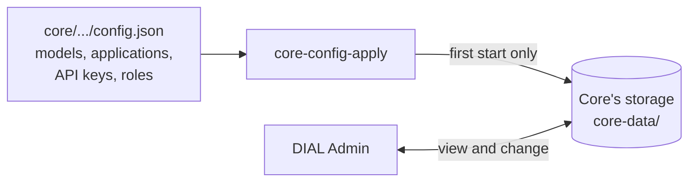

# ai-dial-samples

Run [AI DIAL](https://dialx.ai) on your own computer with one command.

DIAL is a platform that puts many AI models and AI applications behind one
chat window and one API. These samples start everything with Docker, including
small open-source models, so you need **no API keys and no cloud account**.

## Pick a setup

| | [1-dial-simple-setup](1-dial-simple-setup/README.md) | [2-dial-advanced-setup](2-dial-advanced-setup/README.md) |
| --- | --- | --- |
| For | Your first look at DIAL | Exploring everything DIAL can do |
| You get | Chat, Admin and Core, local models, and three sample applications you can change | Everything from setup 1, plus Quick Apps, Scheduler, Evaluation and Analytics |
| Disk space | About 13 GB | About 20 GB |
| Memory for Docker | 16 GB (8 GB without the picture model) | 16 GB |

Start with setup 1. Setup 2 builds on top of it, so you can switch to it later
without losing anything.

## Start in 3 steps

1. Install [Docker Desktop](https://www.docker.com/products/docker-desktop/)
   and start it. In its **Settings → Resources**, give it 16 GB of memory.
2. In a terminal, run:

   ```sh
   cd 1-dial-simple-setup
   docker compose up --wait
   ```

   On a Mac with Apple Silicon (M1 or newer), run
   `echo DIAL_PLATFORM=linux/amd64 >> .env` after `cd 1-dial-simple-setup` and
   before `docker compose up`. DIAL Chat and Admin have no ARM build yet, so
   this tells Docker to run them through emulation. Windows, Linux and Intel Macs
   need nothing.

   The command finishes when DIAL is ready. The first time, it downloads
   everything it needs, which takes a while.
3. Open <http://localhost:8055> and sign in as `dial`, password `dial`.

Say hello to the **qwen2.5** model. 🎉

To manage models and applications, open DIAL Admin at <http://localhost:8056>
and sign in as `dial-admin`, password `dial`.

To stop DIAL, run `docker compose down` in the same folder. Your chats are kept
for the next start.

## What is in this repository

```text
ai-dial-samples/
├── 1-dial-simple-setup/       Step 1: Chat + Admin + Core + local models
│   ├── docker-compose.yml     Which services run
│   ├── keycloak/              Users and passwords for signing in
│   └── dial_entity_samples/   Sample applications and an interceptor, in Python
├── 2-dial-advanced-setup/     Step 2: everything from step 1, plus more services
│   ├── docker-compose.yml     The extra services; includes step 1
│   └── simple-setup-overrides.yml   What step 2 changes in step 1's services
├── core/                      DIAL Core configuration, used by both setups
│   ├── 1-dial-simple-setup/   Models, applications, interceptor, API keys and roles
│   └── 2-dial-advanced-setup/ What setup 2 adds: Quick Apps, Scheduler, Evaluation key
├── core-config-apply/         Copies the files in core/ into Core on the first start
├── core-data/                 Core's storage: chats, files, models, apps (created on first start)
├── logs/                      Core's request logs (created on first start)
└── readmes/                   Reference documentation for each DIAL service
```

`core-data/` and `logs/` stay on your computer; Git ignores them.

## How DIAL Core gets its models and applications

DIAL Core is the gateway in the middle: Chat, Admin and the sample
applications all talk to it. Core keeps its models, applications, interceptors,
API keys and roles in its storage, in `core-data/`. DIAL Admin views and edits
that same storage.

The JSON files in `core/` fill the storage on the first start:



1. On the first `docker compose up`, the `core-config-apply` service sends
   every entity in the setup's `config.json` files to Core, then stops.
2. It lists the files it applied in `core-data/core-config-apply.json`, and
   skips them on every later start.
3. From then on, **change models and applications in DIAL Admin**. Your changes
   are kept across restarts.

So editing a `config.json` file after the first start changes nothing by
itself. To apply your edits, run this in the setup's folder:

```sh
rm ../core-data/core-config-apply.json
docker compose up --wait
```

This applies all files again and overwrites the changes you made in Admin to
the entities in those files. Entities that you created in Admin stay.

Core reads only two small files directly: `core/1-dial-simple-setup/admin-key.json`,
the admin API key that `core-config-apply` signs in with, and, in setup 2,
`core/2-dial-advanced-setup/quick-apps-schemas.json`. For the details, see
[core-config-apply](core-config-apply/README.md).

## How the two setups fit together

Setup 2 does not copy setup 1. Its `docker-compose.yml`
[includes](https://docs.docker.com/compose/how-tos/multiple-compose-files/include/)
setup 1's `docker-compose.yml`, adds services next to it, and changes a few of
setup 1's services in `simple-setup-overrides.yml`.

Both setups use the Docker Compose project name `dial`. Starting setup 2
upgrades a running setup 1 in place and keeps its downloaded models, users and
chats. Setup 2 applies setup 1's `config.json` too, then its own two files:
the Evaluation API key and the Scheduler application.

## Updating from an earlier version of these samples

Earlier versions ran a separate adapter container for each model provider, and
DIAL Core read `config.json` directly. After `git pull`, run this in the
folder of the setup you use:

```sh
docker compose up --wait --build --remove-orphans
```

- `--remove-orphans` removes containers that the setup no longer uses, such as
  the old adapters and InfluxDB.
- `core-config-apply` copies the models and applications into Core's storage
  on this start. If Core already stores models that point to the old adapters,
  it moves them to the new Model Provider. Your chats are kept.
- If your `.env` came from an older `.env.example`, delete its `*_VERSION`
  lines: some of those images were renamed or replaced.

## Learn more

- [DIAL documentation](https://docs.dialx.ai)
- [DIAL on GitHub](https://github.com/epam/ai-dial)
- [Contributing](CONTRIBUTING.md)
