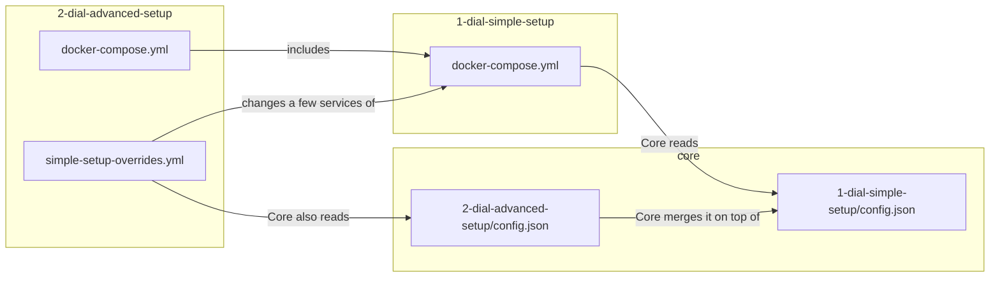

# ai-dial-samples

Run [AI DIAL](https://dialx.ai) on your own computer with one command.

DIAL is a platform that puts many AI models and AI applications behind one
chat window and one API. These samples start everything with Docker, including
a small open-source model, so you need **no API keys and no cloud account**.

## Pick a setup

| | [1-dial-simple-setup](1-dial-simple-setup/README.md) | [2-dial-advanced-setup](2-dial-advanced-setup/README.md) |
| --- | --- | --- |
| For | Your first look at DIAL | Exploring everything DIAL can do |
| You get | Chat, Core, Quick Apps, two local chat models and an embedding model | Everything from setup 1, plus Admin, Evaluation, Analytics, two sample DIAL entities written in Python and roles that control who sees which models |
| Disk space | About 8 GB | About 20 GB |
| Memory for Docker | 8 GB | 16 GB |

Start with setup 1. Setup 2 builds on top of it, so you can switch to it later
without losing anything.

## Start in 3 steps

1. Install [Docker Desktop](https://www.docker.com/products/docker-desktop/)
   and start it. In its **Settings → Resources**, give it at least 8 GB of memory.
2. In a terminal, run:

   ```sh
   cd 1-dial-simple-setup
   docker compose up --wait
   ```

   On a Mac with Apple Silicon (M1 or newer), run
   `echo DIAL_PLATFORM=linux/amd64 >> .env` after `cd 1-dial-simple-setup` and
   before `docker compose up`. DIAL Chat and Quick Apps have no ARM build yet, so
   this tells Docker to run them through emulation. Windows, Linux and Intel Macs
   need nothing.

   The command finishes when DIAL is ready. The first time, it downloads
   everything it needs, which takes a few minutes.
3. Open <http://localhost:8055> and sign in as `user`, password `dial`.

Say hello to the **qwen2.5** model. 🎉

To stop DIAL, run `docker compose down` in the same folder. Your chats are kept
for the next start.

## What is in this repository

```text
ai-dial-samples/
├── 1-dial-simple-setup/       Step 1: Chat + Core + local models
│   ├── docker-compose.yml     Which services run
│   └── keycloak/              Users and passwords for signing in
├── 2-dial-advanced-setup/     Step 2: everything from step 1, plus more services
│   ├── docker-compose.yml     The extra services; includes step 1
│   ├── simple-setup-overrides.yml   What step 2 changes in step 1's services
│   └── dial_entity_samples/   Python code for a DIAL application and interceptor
├── core/                      DIAL Core configuration, used by both setups
│   ├── settings.json          Server settings
│   ├── gflog.xml              Where Core writes its logs
│   ├── 1-dial-simple-setup/   Models, applications, API keys and Quick Apps of step 1
│   └── 2-dial-advanced-setup/ What step 2 adds: applications, interceptor, more models, roles
├── core-data/                 DIAL Core storage: chats, files (created on first start)
├── logs/                      DIAL Core request logs (created on first start)
└── readmes/                   Reference documentation for each DIAL service
```

Both setups run the same DIAL Core, so its folders sit in the repository root:
`core/` is its configuration, and Core keeps your data in `core-data/` and
writes its logs to `logs/`. Both folders stay on your computer; Git ignores them.

## How the two setups fit together

Setup 2 does not copy setup 1. Its `docker-compose.yml`
[includes](https://docs.docker.com/compose/how-tos/multiple-compose-files/include/)
setup 1's `docker-compose.yml` and adds services next to it:



DIAL Core works the same way: setup 1's Core reads
`core/1-dial-simple-setup/config.json`. Setup 2's Core reads that file first,
then the files in `core/2-dial-advanced-setup/`, and merges them. A change for
setup 1 therefore also appears in setup 2.

Both setups use the Docker Compose project name `dial`. Starting setup 2
upgrades a running setup 1 in place and reuses its downloaded models, users and
chats.

## Learn more

- [DIAL documentation](https://docs.dialx.ai)
- [DIAL on GitHub](https://github.com/epam/ai-dial)
- [Contributing](CONTRIBUTING.md)
